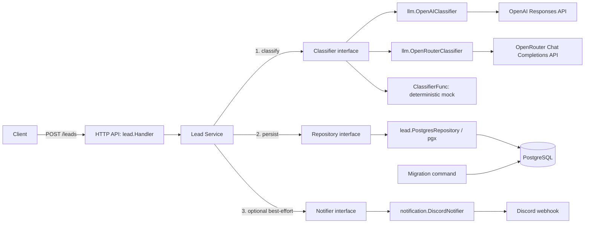

# AI Lead Intake & Qualification

A Go API that accepts leads, validates input, classifies the inquiry, persists the
result in PostgreSQL, and optionally notifies a sales team through Discord.
The portfolio demo runs without paid API access using a deterministic mock classifier.

## Demo

[](https://youtu.be/fwRQ8wB_IvA)

Watch the end-to-end workflow:
Lead Intake → AI Classification → PostgreSQL → Discord

## Problem and business value

Inbound inquiries arrive as free text, leaving sales teams to copy contact details,
read each message, and decide what to do next. This project demonstrates one intake
workflow that produces a stored lead with a category, priority, summary, and suggested
next action, with an optional team notification after saving.

The intended value is consistent intake and less manual triage. No time savings,
conversion uplift, classification accuracy, or performance benchmarks have been measured.
Human review remains necessary for model-generated recommendations.

## Feature overview

| Capability | v0.1.0 scope |
| --- | --- |
| Lead intake | `POST /leads`, normalized and validated contact fields |
| Classification | OpenAI / OpenRouter adapters or deterministic, free mock mode |
| Persistence | PostgreSQL insert with generated ID and timestamp; embedded migrations |
| Notifications | Optional synchronous, best-effort Discord webhook after persistence |
| Operations | Liveness endpoint, JSON API logs, graceful shutdown, Docker Compose |

See the [v0.1.0 release notes](docs/release-v0.1.0.md) for verification results,
release scope, and future development opportunities. This is a local portfolio MVP;
production deployment requires additional security and operational work.

## Tech stack

Go 1.27.1, standard-library `net/http`, `encoding/json`, and `log/slog`; pgx v5 for
PostgreSQL; PostgreSQL 17.6 in Docker Compose; OpenAI Responses, OpenRouter Chat Completions, and Discord webhook
HTTP adapters. The automated demo uses Python 3's standard library and Docker Compose.

## Architecture



The vertical slice in `internal/lead` owns validation, orchestration, HTTP handling,
and persistence. `internal/llm` and `internal/notification` contain external adapters;
`cmd/api` wires dependencies using the existing interfaces. No framework or queue is required.

## Prerequisites

- Docker Engine and Docker Compose v2 for the container demo and integration tests.
- Go 1.27.1 for native development (matching `go.mod` and the Docker builder).
- `curl` for the API examples.
- PostgreSQL 17 if using an existing **local development** database instead of Docker.

## Quick start

For an automated, self-checking demo, install Docker Compose and Python 3, then run:

```sh
python3 scripts/demo.py
```

It builds an isolated Compose project on random localhost ports, forces mock
classification and disables external notifications, submits a lead, checks every
persisted field against the response, and checks persistence after restarting the
database and API. It prints the classification and removes only its own temporary
containers and database volume on exit. Existing `.env` credentials are not used.
The first build may download images and Go modules; build images/cache may remain.
If the process is killed before cleanup, use the project name printed at startup
for manual cleanup; do not use `-v` against your normal development project.

### Docker Compose demo

```sh
cp .env.example .env
docker compose up --build -d
# The migrate service should exit with code 0; db and api remain running.
docker compose ps -a
docker compose logs migrate api
curl --fail http://localhost:8080/health
```

Compose waits for PostgreSQL's health check, runs migrations, then starts the API.
The API runs as UID/GID 65532 with a read-only scratch filesystem and no Linux
capabilities. The multi-stage build includes CA certificates for HTTPS and embeds
no credentials. PostgreSQL data lives in the `postgres_data` named volume.
Ports bind to localhost by default. The API listens on port 8080 inside its container.

```sh
# Stop without deleting persisted data.
docker compose down
# Apply new migrations on an existing installation before recreating the API.
docker compose build
docker compose stop api
docker compose run --rm migrate
docker compose up -d
```

`docker compose down -v` permanently deletes this Compose project's database volume.
Change `PORT` or `POSTGRES_PORT` if the default host ports are occupied.

### Local setup

```sh
cp .env.example .env
# Load only a trusted local .env file; the Go application does not load it itself.
set -a
. ./.env
set +a
docker compose up -d --wait db
go run ./cmd/migrate
go run ./cmd/api
```

`DATABASE_URL` is required by native API and migration commands. If changing
PostgreSQL credentials or its host port, update this URL too. Compose constructs
its own internal URL using the `POSTGRES_*` variables and `db:5432`.

## Environment configuration

| Variable | Purpose / default in `.env.example` |
| --- | --- |
| `PORT` | Native HTTP port / Compose published API port, `8080` |
| `DATABASE_URL` | Native PostgreSQL connection URL; required |
| `POSTGRES_USER` | Compose database user, `lead` |
| `POSTGRES_PASSWORD` | Required Compose database password; example is local-only |
| `POSTGRES_DB` | Compose database name, `ai_lead_automation` |
| `POSTGRES_PORT` | Compose published PostgreSQL port, `5432` |
| `CLASSIFIER_MODE` | `mock` for the demo, `openai`, or `openrouter`; native unset retains `openai` behavior |
| `OPENAI_API_KEY` | Required only in OpenAI mode; blank in the example |
| `OPENAI_MODEL` | Required in OpenAI mode; example: `gpt-4o-mini` |
| `OPENROUTER_API_KEY` | Required only in OpenRouter mode; blank in the example |
| `OPENROUTER_MODEL` | OpenRouter model; defaults to `openrouter/free` when empty |
| `DISCORD_WEBHOOK_URL` | Optional incoming webhook URL; blank disables notifications |
| `RUN_POSTGRES_TESTS` | `1` opts into isolated Docker integration tests; default `0` |

The mock always returns `sales`, `normal`, `Demo lead received.`, and
`Review the lead and contact the prospect.` regardless of input. It performs no
network calls. Notifications remain independently configurable; leave the webhook
empty for an offline demo apart from the local database.

OpenAI mode uses the existing Responses API adapter with structured classification.
It sends only company and message with `store: false`. The configured model must
support Responses and Structured Outputs. Calls have a 30-second timeout and
respect cancellation. API failures, refusals, incomplete responses, and invalid
classifications fail creation before persistence.

`.env` is ignored by Git and excluded from the Docker build context. Never commit
real credentials. The sample database password is only for local demonstrations.
Compose interpolates user/password/database into a URL: use URL-safe local values;
for native deployments, percent-encode reserved characters in `DATABASE_URL`.
Changing `POSTGRES_*` does not change users/passwords in an already initialized volume.

### OpenRouter configuration and manual smoke test

OpenRouter mode uses `POST https://openrouter.ai/api/v1/chat/completions` with
Bearer authentication. It shares OpenAI's classification instructions, JSON schema,
and local validation. The system message treats lead fields as untrusted data;
the JSON user message contains only company and message, never separate name/email
fields. Free text may still contain personal information. No tools are offered or
executed, and tool-call responses are rejected. Prompt instructions do not guarantee
semantic accuracy or immunity to prompt injection; review generated recommendations.

Requests use strict `response_format: json_schema` and
`provider.require_parameters: true` to select compatible providers, following
[OpenRouter structured-output guidance](https://openrouter.ai/docs/guides/features/structured-outputs).
Provider fallback is disabled with `allow_fallbacks: false`; the adapter does not
retry or substitute mock classifications. Only a single assistant message ending
with `finish_reason: stop` is accepted. Refusals, truncation, malformed output,
unsupported parameters, and provider failures fail creation before persistence.
Requests have a 30-second deadline and a 1 MiB response limit; redirects are rejected.
Errors exclude raw provider bodies and transport details that could contain secrets.

The default `openrouter/free` selects from available free models. Availability,
structured-output support, and rate limits can change; a compatible free provider
may be unavailable. See the [free router](https://openrouter.ai/openrouter/free).
An explicitly selected model may have different pricing. OpenRouter requires its
own key; `OPENAI_API_KEY` is not needed. On 2026-10-12, I tested
a live OpenRouter request through the application and received HTTP `201` with a
meaningful category, priority, summary, and recommended action. This manual smoke
test was not independently reproduced during release preparation and is not a CI
result or an evaluation of classification accuracy, reliability, or production performance.
Unit tests use an injected HTTP transport without provider network requests.
The OpenAI adapter has automated tests but remains unverified against the live OpenAI API.

To perform an optional live smoke test yourself:

1. Use the local Compose setup above. In your ignored `.env`, set
   `CLASSIFIER_MODE=openrouter`, set `OPENROUTER_API_KEY` privately, and set
   `OPENROUTER_MODEL=openrouter/free`. Leave `OPENAI_API_KEY` and
   `DISCORD_WEBHOOK_URL` empty. Do not put the key in shell history or shared logs.
2. Ensure your shell does not override those `.env` settings, then run:

   ```sh
   docker compose up --build -d
   curl --fail http://localhost:8080/health
   curl --fail-with-body -i http://localhost:8080/leads \
     -H 'Content-Type: application/json' \
     -d '{"name":"Demo","email":"demo@example.com","company":"Acme","message":"We need invoice automation."}'
   ```

3. Expect HTTP `201` with valid category/priority and nonempty summary/action;
   wording varies by model. Use the SQL example below to inspect persistence.
   HTTP `500` indicates classification or database failure; safe API logs can
   distinguish authentication (`401`), rate limits (`429`), unsupported parameters,
   and provider availability errors. Health alone does not exercise the classifier.
4. Return `CLASSIFIER_MODE` to `mock` and clear the OpenRouter key when finished.
   Run `docker compose up -d` to apply the change, or `docker compose down` to stop.

The automated `python3 scripts/demo.py` remains mock-only and explicitly clears
OpenAI, OpenRouter, and Discord credentials, including inherited shell values.

## Migrations

```sh
go run ./cmd/migrate
# Or, with Compose's database:
docker compose run --rm migrate
```

The existing numbered SQL files in `migration/` are embedded in the migration
binary and applied in filename order. `schema_migrations` records completed files.
A transaction covers all pending migrations and history updates; a PostgreSQL
advisory lock serializes simultaneous runners. Any failure rolls back the run and
exits nonzero. Re-running leaves applied files and existing leads intact.

Add new numbered SQL files rather than editing applied ones. Rebuild the image
when adding migrations. Migrations must support transactional execution; there is
no down-migration or checksum framework. Back up important data before upgrades.
A database previously migrated manually has no history: this runner deliberately
fails on existing tables rather than guessing a baseline. For that case, verify
the schema against every SQL file and baseline it under operator supervision, or
start a new disposable demo database. Do not reset a shared database.

## API examples

```sh
curl --fail http://localhost:8080/health

curl --fail-with-body -i http://localhost:8080/leads \
  -H 'Content-Type: application/json' \
  -d '{"name":"Jane Doe","email":"jane@example.com","company":"Acme","message":"We need invoice automation."}'
```

Successful creation returns HTTP `201` with the persisted ID, timestamp, and classification:

```json
{
  "id": 1,
  "name": "Jane Doe",
  "email": "jane@example.com",
  "company": "Acme",
  "message": "We need invoice automation.",
  "classification": {
    "category": "sales",
    "priority": "normal",
    "summary": "Demo lead received.",
    "recommended_action": "Review the lead and contact the prospect."
  },
  "created_at": "2026-10-10T10:00:00Z"
}
```

IDs and timestamps vary. Name, valid email, and message are required; company is
optional. Limits are 200 characters for name/company, 320 bytes for email, 10,000
characters for message, and 1 MiB for request bodies. Unknown fields and multiple
JSON objects are rejected. Validation errors return `400` with `{"error":"..."}`;
classification/database failures return `500` with a generic error.

Read persisted data directly for demonstration (there is no GET lead endpoint):

```sh
docker compose exec db sh -c 'psql -U "$POSTGRES_USER" -d "$POSTGRES_DB" -c "SELECT id, name, category, priority, created_at FROM leads ORDER BY id DESC LIMIT 10"'
```

## Testing

GitHub Actions [CI](.github/workflows/ci.yml) runs on every push and pull request.
Both jobs use the Go version in `go.mod`. The Go job runs tests, vet, and build;
the separate PostgreSQL job runs the existing disposable-container test with
`RUN_POSTGRES_TESTS=1` and `-count=1` so cached results cannot bypass the database.
CI needs no OpenAI, OpenRouter, Discord, or database secrets. GitHub confirms both
jobs passed on `main` at `93082115bb349f0dcf1df2a31d59c026de78a3a8` on 2026-10-13
([CI run](https://github.com/Tranduy1dol/ai-lead-automation/actions/runs/38431999334)).
See the dated [verification record](docs/release-v0.1.0.md#verification-record);
these results precede the final release documentation changes.

```sh
go test ./...
go vet ./...
go build ./...
# Requires a running Docker daemon; no Compose stack or database URL is needed.
RUN_POSTGRES_TESTS=1 go test ./... -count=1 -v
```

Normal tests use deterministic stubs and HTTP mocks; the PostgreSQL test reports a
skip unless explicitly enabled. Integration tests start their own PostgreSQL 17.6
container on a random loopback port with temporary memory-backed storage, wait for
readiness, and remove it on completion. They never read `DATABASE_URL` or attach
existing volumes. A Docker failure after opting in fails the test instead of skipping.
Abruptly killing the test process can leave its disposable container running; remove
that test container manually if necessary.

Coverage includes successful inserts, all persisted fields read back via SQL,
constraint errors without partial inserts, cancellation, a closed database pool,
migration rollback on failure, concurrent migration runners, and repeat migrations
preserving data. Existing tests cover service ordering, validation, HTTP error
responses, and mocked OpenAI/OpenRouter/Discord behavior. Integration tests may download the
PostgreSQL image on their first run.

## Discord notifications

Discord is optional and best-effort. Persistence happens first, followed by one
synchronous notification attempt with a five-second timeout and caller cancellation.
Failures are logged with the lead ID but preserve the `201` response. Notifications
include lead ID, company, and classification fields; empty fields use `(not provided)`
and long fields are truncated to 900 UTF-8 bytes. Mentions are disabled. The adapter
requests send confirmation, rejects non-2xx responses, and does not retry or follow redirects.
See the [Discord webhook API](https://docs.discord.com/developers/resources/webhook#execute-webhook).

On 2026-10-12, I received a real Discord notification during a manual smoke test
containing lead ID, company, category, priority, classification summary, and recommended
action. This was a manual smoke test, not a CI result or an independently reproduced
delivery check during release preparation; it does not establish delivery reliability.

## Current scope and future development

v0.1.0 demonstrates the complete lead intake workflow locally. Potential extensions
can be scoped around a team's sales process; these are development opportunities,
not features included in this release or a committed delivery schedule.

| Development area | Current scope | Potential extension |
| --- | --- | --- |
| Deployment security | Local demo; no authentication, rate limiting, or TLS termination | Access controls and production deployment hardening |
| Notification delivery | One best-effort attempt after persistence; delivery can be lost | Durable delivery, retries, and delivery tracking |
| Duplicate prevention | No idempotency key; repeated POST requests can create duplicate leads | Safe request retries with idempotency keys |
| Lead management | Intake API and SQL inspection; no read/list/update/delete API, UI, or CRM integration | Lead review tools and CRM integration |
| Classification evaluation | Deterministic mock and a live OpenRouter smoke test; live OpenAI unverified | Live OpenAI verification and quality evaluation on representative inquiries |
| Data lifecycle | No retention, consent, or automated deletion workflow | Client-specific data handling and retention controls |

See the [release notes](docs/release-v0.1.0.md#current-scope-and-future-development)
for the verification boundaries and development scope. No classification accuracy,
reliability, or performance benchmarks are claimed.

### Deployment considerations

- Keep access local until deployment controls are in place. Native HTTP binds all
  interfaces; only request headers have a read timeout. Request bodies have a size
  cap but no read deadline.
- Company and message may contain personal information sent to the classifier;
  company and generated classification content can also reach Discord. Define data
  handling requirements before using real customer inquiries.
- `/health` reports liveness and does not check the database after startup.
- The Compose database user is a bootstrap superuser. Provision a restricted
  application role separately from the migration role for a deployed service.
- Container tags are versioned but not digest-pinned; builds are not bit-for-bit
  reproducible. Include image updates and security review in deployment planning.
