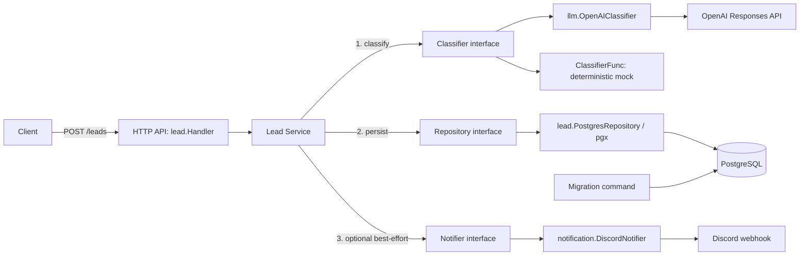

# AI Lead Intake & Qualification

A Go API that accepts leads, validates input, classifies the inquiry, persists the
result in PostgreSQL, and optionally notifies a sales team through Discord.
The portfolio demo runs without paid API access using a deterministic mock classifier.

## Problem and business value

Inbound inquiries arrive as free text, leaving sales teams to copy contact details,
read each message, and decide what to do next. This project demonstrates one intake
workflow that produces a stored lead with a category, priority, summary, and suggested
next action, with an optional team notification after saving.

The intended value is consistent intake and less manual triage. No time savings,
conversion uplift, classification accuracy, or performance benchmarks have been measured.
Human review remains necessary for model-generated recommendations.

## Feature overview

| Capability | v0.1.0 scope |
| --- | --- |
| Lead intake | `POST /leads`, normalized and validated contact fields |
| Classification | OpenAI adapter or deterministic, free mock mode |
| Persistence | PostgreSQL insert with generated ID and timestamp; embedded migrations |
| Notifications | Optional synchronous, best-effort Discord webhook after persistence |
| Operations | Liveness endpoint, JSON API logs, graceful shutdown, Docker Compose |

See the [release audit and checklist](docs/release-v0.1.0.md) for executed checks,
unverified integrations, and outstanding issues. This is a local portfolio release,
not a production deployment configuration.

## Tech stack

Go 1.27.1, standard-library `net/http`, `encoding/json`, and `log/slog`; pgx v5 for
PostgreSQL; PostgreSQL 17.6 in Docker Compose; OpenAI Responses and Discord webhook
HTTP adapters. The automated demo uses Python 3's standard library and Docker Compose.

## Architecture



The vertical slice in `internal/lead` owns validation, orchestration, HTTP handling,
and persistence. `internal/llm` and `internal/notification` contain external adapters;
`cmd/api` wires dependencies using the existing interfaces. No framework or queue is required.

## Prerequisites

- Docker Engine and Docker Compose v2 for the container demo and integration tests.
- Go 1.27.1 for native development (matching `go.mod` and the Docker builder).
- `curl` for the API examples.
- PostgreSQL 17 if using an existing **local development** database instead of Docker.

## Quick start

For an automated, self-checking demo, install Docker Compose and Python 3, then run:

```sh
python3 scripts/demo.py
```

It builds an isolated Compose project on random localhost ports, forces mock
classification and disables external notifications, submits a lead, checks every
persisted field against the response, and checks persistence after restarting the
database and API. It prints the classification and removes only its own temporary
containers and database volume on exit. Existing `.env` credentials are not used.
The first build may download images and Go modules; build images/cache may remain.
If the process is killed before cleanup, use the project name printed at startup
for manual cleanup; do not use `-v` against your normal development project.

### Docker Compose demo

```sh
cp .env.example .env
docker compose up --build -d
# The migrate service should exit with code 0; db and api remain running.
docker compose ps -a
docker compose logs migrate api
curl --fail http://localhost:8080/health
```

Compose waits for PostgreSQL's health check, runs migrations, then starts the API.
The API runs as UID/GID 65532 with a read-only scratch filesystem and no Linux
capabilities. The multi-stage build includes CA certificates for HTTPS and embeds
no credentials. PostgreSQL data lives in the `postgres_data` named volume.
Ports bind to localhost by default. The API listens on port 8080 inside its container.

```sh
# Stop without deleting persisted data.
docker compose down
# Apply new migrations on an existing installation before recreating the API.
docker compose build
docker compose stop api
docker compose run --rm migrate
docker compose up -d
```

`docker compose down -v` permanently deletes this Compose project's database volume.
Change `PORT` or `POSTGRES_PORT` if the default host ports are occupied.

### Local setup

```sh
cp .env.example .env
# Load only a trusted local .env file; the Go application does not load it itself.
set -a
. ./.env
set +a
docker compose up -d --wait db
go run ./cmd/migrate
go run ./cmd/api
```

`DATABASE_URL` is required by native API and migration commands. If changing
PostgreSQL credentials or its host port, update this URL too. Compose constructs
its own internal URL using the `POSTGRES_*` variables and `db:5432`.

## Environment configuration

| Variable | Purpose / default in `.env.example` |
| --- | --- |
| `PORT` | Native HTTP port / Compose published API port, `8080` |
| `DATABASE_URL` | Native PostgreSQL connection URL; required |
| `POSTGRES_USER` | Compose database user, `lead` |
| `POSTGRES_PASSWORD` | Required Compose database password; example is local-only |
| `POSTGRES_DB` | Compose database name, `ai_lead_automation` |
| `POSTGRES_PORT` | Compose published PostgreSQL port, `5432` |
| `CLASSIFIER_MODE` | `mock` for the demo, or `openai`; native unset retains `openai` behavior |
| `OPENAI_API_KEY` | Required only in OpenAI mode; blank in the example |
| `OPENAI_MODEL` | Required in OpenAI mode; example: `gpt-4o-mini` |
| `DISCORD_WEBHOOK_URL` | Optional incoming webhook URL; blank disables notifications |
| `RUN_POSTGRES_TESTS` | `1` opts into isolated Docker integration tests; default `0` |

The mock always returns `sales`, `normal`, `Demo lead received.`, and
`Review the lead and contact the prospect.` regardless of input. It performs no
network calls. Notifications remain independently configurable; leave the webhook
empty for an offline demo apart from the local database.

OpenAI mode uses the existing Responses API adapter with structured classification.
It sends only company and message with `store: false`. The configured model must
support Responses and Structured Outputs. Calls have a 30-second timeout and
respect cancellation. API failures, refusals, incomplete responses, and invalid
classifications fail creation before persistence.

`.env` is ignored by Git and excluded from the Docker build context. Never commit
real credentials. The sample database password is only for local demonstrations.
Compose interpolates user/password/database into a URL: use URL-safe local values;
for native deployments, percent-encode reserved characters in `DATABASE_URL`.
Changing `POSTGRES_*` does not change users/passwords in an already initialized volume.

## Migrations

```sh
go run ./cmd/migrate
# Or, with Compose's database:
docker compose run --rm migrate
```

The existing numbered SQL files in `migration/` are embedded in the migration
binary and applied in filename order. `schema_migrations` records completed files.
A transaction covers all pending migrations and history updates; a PostgreSQL
advisory lock serializes simultaneous runners. Any failure rolls back the run and
exits nonzero. Re-running leaves applied files and existing leads intact.

Add new numbered SQL files rather than editing applied ones. Rebuild the image
when adding migrations. Migrations must support transactional execution; there is
no down-migration or checksum framework. Back up important data before upgrades.
A database previously migrated manually has no history: this runner deliberately
fails on existing tables rather than guessing a baseline. For that case, verify
the schema against every SQL file and baseline it under operator supervision, or
start a new disposable demo database. Do not reset a shared database.

## API examples

```sh
curl --fail http://localhost:8080/health

curl --fail-with-body -i http://localhost:8080/leads \
  -H 'Content-Type: application/json' \
  -d '{"name":"Jane Doe","email":"jane@example.com","company":"Acme","message":"We need invoice automation."}'
```

Successful creation returns HTTP `201` with the persisted ID, timestamp, and classification:

```json
{
  "id": 1,
  "name": "Jane Doe",
  "email": "jane@example.com",
  "company": "Acme",
  "message": "We need invoice automation.",
  "classification": {
    "category": "sales",
    "priority": "normal",
    "summary": "Demo lead received.",
    "recommended_action": "Review the lead and contact the prospect."
  },
  "created_at": "2026-10-10T10:00:00Z"
}
```

IDs and timestamps vary. Name, valid email, and message are required; company is
optional. Limits are 200 characters for name/company, 320 bytes for email, 10,000
characters for message, and 1 MiB for request bodies. Unknown fields and multiple
JSON objects are rejected. Validation errors return `400` with `{"error":"..."}`;
classification/database failures return `500` with a generic error.

Read persisted data directly for demonstration (there is no GET lead endpoint):

```sh
docker compose exec db sh -c 'psql -U "$POSTGRES_USER" -d "$POSTGRES_DB" -c "SELECT id, name, category, priority, created_at FROM leads ORDER BY id DESC LIMIT 10"'
```

## Testing

```sh
go test ./...
go vet ./...
go build ./...
# Requires a running Docker daemon; no Compose stack or database URL is needed.
RUN_POSTGRES_TESTS=1 go test ./... -count=1 -v
```

Normal tests use deterministic stubs and HTTP mocks; the PostgreSQL test reports a
skip unless explicitly enabled. Integration tests start their own PostgreSQL 17.6
container on a random loopback port with temporary memory-backed storage, wait for
readiness, and remove it on completion. They never read `DATABASE_URL` or attach
existing volumes. A Docker failure after opting in fails the test instead of skipping.
Abruptly killing the test process can leave its disposable container running; remove
that test container manually if necessary.

Coverage includes successful inserts, all persisted fields read back via SQL,
constraint errors without partial inserts, cancellation, a closed database pool,
migration rollback on failure, concurrent migration runners, and repeat migrations
preserving data. Existing tests cover service ordering, validation, HTTP error
responses, and mocked OpenAI/Discord behavior. Integration tests may download the
PostgreSQL image on their first run.

## Discord notifications and known limitations

Discord is optional and best-effort. Persistence happens first, followed by one
synchronous notification attempt with a five-second timeout and caller cancellation.
Failures are logged with the lead ID but preserve the `201` response. Notifications
include lead ID, company, and classification fields; empty fields use `(not provided)`
and long fields are truncated to 900 UTF-8 bytes. Mentions are disabled. The adapter
requests send confirmation, rejects non-2xx responses, and does not retry or follow redirects.
See the [Discord webhook API](https://docs.discord.com/developers/resources/webhook#execute-webhook).

- A crash, timeout, cancellation, or Discord outage can lose a notification; timeout
  delivery may be uncertain. There is no durable outbox or queue.
- Repeating `POST /leads` can create duplicates; there is no idempotency key.
- The mock demonstrates the workflow, not semantic lead qualification.
- There is no lead listing, retrieval, update, or deletion API, user interface,
  CRM integration, or asynchronous processing. Use SQL to inspect demo persistence.
- Only request headers have a server read timeout; body reads have a size limit
  but no read deadline. Native HTTP binds all interfaces. Keep access local or
  behind deployment controls with appropriate timeouts.
- Company and message can contain personal information sent to the classifier;
  company and generated classification text can also reach Discord. No retention,
  consent, or automated deletion workflow is implemented.
- `/health` is a liveness endpoint and does not check the database after startup.
- No authentication, rate limiting, or TLS termination is provided. This is a local
  portfolio demo; add deployment access controls before public exposure.
- Container tags pin versions but not image digests; builds are not bit-for-bit
  reproducible. Review base-image updates as part of deployment maintenance.
- The Compose database user is the image's bootstrap superuser. A real deployment
  should provision a restricted application role separately from the migration role.
